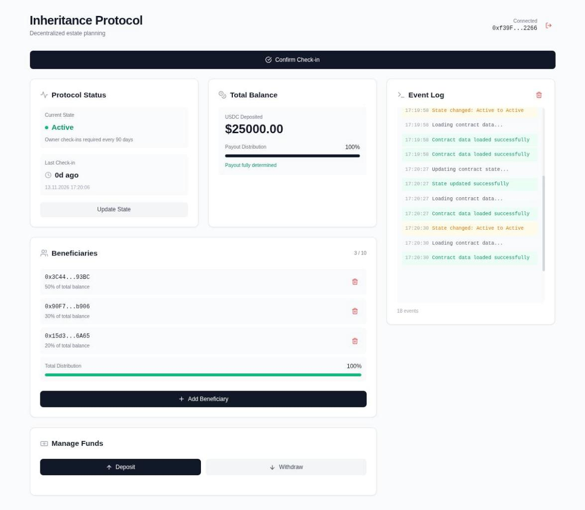

# Decentralized Inheritance Protocol

Group project for the course *Smart Contracts and Decentralized Finance* (University of Basel, HS 2025).

A blockchain-based digital will: the owner deposits USDC and names up to 10 beneficiaries with percentage shares. As long as the owner checks in regularly, the funds stay theirs and earn yield through an (Aave-style) lending pool. If check-ins stop, the contract moves through four phases (Active → Warning → Verification → Distribution); once a notary confirms the death via an oracle, the assets are paid out automatically.

Built with Solidity, OpenZeppelin, Hardhat 3 (61 tests) and a Next.js client. Details in the [report](docs/report/report.pdf).



## Quick Start

### Installation

```bash
# Install contract dependencies
cd contract && npm install && cd ..

# Install client dependencies
cd client && npm install && cd ..
```

### Running the Application

**Terminal 1** - Start local blockchain:
```bash
npx hardhat node
```
MetaMask Chain ID: `31337`

**Terminal 2** - Deploy contracts:
```bash
npm run auto-deploy
```

**Terminal 3** - Run frontend:
```bash
cd client
npm run dev
```

App running on `http://localhost:3000`

### MetaMask Setup
- Add custom RPC: `http://localhost:8545`
- Chain ID: `31337`
- Import test account from Hardhat output

## Referenced Documents

* [CONTRIBUTING](CONTRIBUTING.md)
* [License](LICENSE.md)
* [Description](description.txt)
* [LatexREADME](docs/report/README.md)

## Scripts

* [LatexBuild](docs/report/build.sh)
* [Cleanup](cleanup.js)

## Roadmap

### Core Contract Features
- **Beneficiary management logic**
    - [x] Implemented
    - [x] Tested
- **Transferring and withdrawing assets (use mock USDC)**
    - [x] Implemented
    - [x] Tested
- **State handling: check-ins (liveness proof with timer reset)**
    - [x] Implemented
    - [x] Tested
- **State handling: phase transitions (Active → Warning → Verification → Distribution)**
    - [x] Implemented
    - [x] Tested
- **Verification phase: mocking death certificates**
    - [x] Implemented
    - [x] Tested
- **Payout logic (trigger distribution with percentage-based shares)**
    - [x] Implemented
    - [x] Tested
- **Yield generation**
    - [x] Implemented
    - [x] Tested

### Client / UX
- [x] **Basic setup: view functionality**
- [x] **Interaction with Deployed InheritanceProtocol contract (Deposit, Withdraw, Yield / View account, Beneficiary Management, CheckIns, Death verification)**

## Hardhat version

This project uses hardhat v3. See the [documentation](https://hardhat.org/docs/getting-started).

## Styleguide

Usage of [NatSpec](https://docs.soliditylang.org/en/latest/natspec-format.html) style comments is encouraged.
